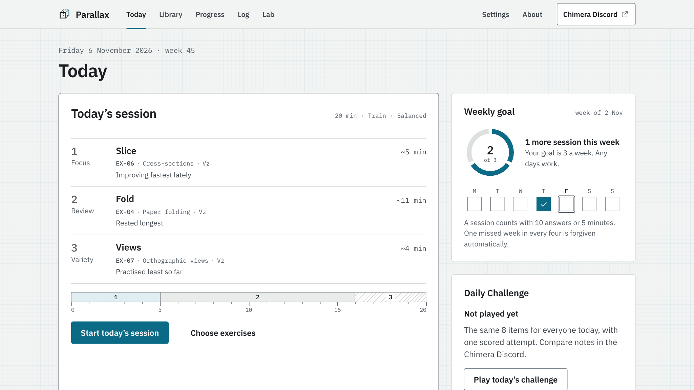

# Parallax

Parallax is a free, open-source web app that trains visuospatial ability: picturing objects as they turn, fold, are cut, or are seen from somewhere else. It runs offline in any modern browser, keeps everything on your device, and measures whether your practice carries over to tasks you never train, instead of promising that it does.



**Built by the Chimera community on Discord: [discord.gg/chmr](https://discord.gg/chmr).** Come and say hi, share your results, and suggest exercises you would like to train.

The full user guide, with the research behind every design choice, is [docs/Parallax-Guide.pdf](docs/Parallax-Guide.pdf).

## Features

- **Eleven exercises**, every item generated fresh and checked by a solver: Track (3D multiple-object tracking, labelled attention practice), Rotate (3D mental rotation), Spin (2D speeded rotation), Fold (paper folding), Nets (cube nets), Slice (cross-sections), Views (orthographic views), Orient (perspective taking), Span (block span), Hidden (hidden shapes) and Homing (experimental navigation).
- **Five ways to practise and one to measure, on one record:** Train (mixed, adaptive sessions), Path (ten gated stages per exercise), Threshold (staircases; for 3D tracking, a staircase after Legault et al. (2013), in Parallax's own units, not comparable with published thresholds), Speed (deadlines once accuracy is there), Free play, and the Spatial Check. Plus a Daily Challenge: the same 8 items for everyone each day.
- **A Spatial Check that measures transfer honestly:** short adaptive probes you never practise, without feedback, from two baselines, compared with a non-spatial control task and with your own familiarity gain. It says "beyond familiarity", "unclear yet" or "no change"; "unclear yet" is the usual result for weeks, often months, and not the same as no progress. Pooled data is where transfer can really be measured: share your Lab research export in the Discord if you would like to help.
- **Feedback that explains:** after a miss, a slow, pausable "show me" built from the same model that graded the answer; tags that say what each wrong option shows.
- **Watch, Try, Go** tutorials, just-in-time tips, and two strategy cards per exercise (one picturing, one step by step) with advice on when to switch.
- **Honest progress:** levels 1–100 with a likely range and the real settings you handle, learning curves with a noise band, a weekly goal with grace, achievements for skills and good practice. No points for time, no leaderboards, no daily loss-framed streaks, no IQ, percentile or "brain age".
- **Runs everywhere:** from a file, on GitHub Pages, in sandboxed previews and on phones; keyboard everywhere, 44-pixel touch targets, colour never the only cue, reduced motion respected.
- **Your data stays yours:** no account, no analytics, no ads. Back up and restore as JSON, export trials as CSV, and a research export in the Lab.

## What it can and cannot do

Practice improves the practised tasks and often similar spatial tests: across 206 training studies, spatial practice raised spatial test scores by about half a standard deviation, and untrained spatial tests gained about as much (Uttal et al., 2013). Effects on grades, work, sport or IQ are not established: gains in school mathematics are small and shown mainly in children and teenagers (Hawes et al., 2022), and there is no good evidence that spatial training raises intelligence. So Parallax measures your transfer instead of promising it. It is a practice tool, not a test of intelligence and not a medical or diagnostic tool, and it has no clones of clinical subtests such as Wechsler Block Design or Visual Puzzles. Practising block-tapping spans can raise scores on clinical block-tapping tests: if you take one, mention your practice.

## Quick start

- **One file:** download `dist/Parallax.html` and open it in a browser. It inlines every script, stylesheet and font, so it works offline, from disk and in sandboxed previews.
- **The repository:** clone or download it and open `index.html`. There is nothing to build.
- **GitHub Pages:** push the repository to GitHub, then in the repository's **Settings → Pages** choose **Deploy from a branch**, the main branch and the root folder.

On first open, the Chimera pop-up appears (it appears every time), then a short tour (Rotate, Fold, Track) and the offer of a first baseline Spatial Check. The default routine is about 20 minutes, three times a week. On iPhone and iPad, Safari may clear site data after 7 days without a visit: add Parallax to the home screen or back up.

## Running the tests

The whole suite in one command: the Node tests, then every browser test, two at a time, with a summary in `tests/e2e/out/run_all.json`. On GitHub, Actions runs the Node tests on every push and pull request (`.github/workflows/tests.yml`).

```sh
npm install
pip install playwright && python -m playwright install chromium
tests/run_all.sh                          # RUN_ALL_SKIP=longrun leaves out the long bot run
```

Node (generators with at least 10,000 seeds each, shortcut solvers, the engine, simulated learners):

```sh
npm test                                  # every exercise, probe and the engine
node tests/node/run.mjs rotate            # one exercise
node tests/node/sim.mjs --learners 200    # simulated learners over 60 days
```

Browser (Python Playwright, headless Chromium). `tests/e2e/pwslot.sh` lets at most two browsers run at once on one machine:

```sh
tests/e2e/pwslot.sh python3 tests/e2e/shell.py            # app shell, Chimera pop-up, settings
tests/e2e/pwslot.sh python3 tests/e2e/play.py             # the player, feedback, show me, sessions
tests/e2e/pwslot.sh python3 tests/e2e/flows.py            # tour, Spatial Check, Daily Challenge
tests/e2e/pwslot.sh python3 tests/e2e/screens.py          # Library, Progress, Log, Lab, share cards
tests/e2e/pwslot.sh python3 tests/e2e/harness_rotate.py   # one exercise in the dev harness (any id)
tests/e2e/pwslot.sh python3 tests/e2e/single.py           # the single-file build
tests/e2e/pwslot.sh python3 tests/e2e/longrun.py          # a bot plays 300 trials in each mode
```

Builds:

```sh
node tools/build-single.mjs                          # dist/Parallax.html
tests/e2e/pwslot.sh python3 tools/shots.py           # figures for the guide (docs/shots/)
tests/e2e/pwslot.sh python3 tools/build-pdf.py       # docs/Parallax-Guide.pdf from docs/guide/
```

## Repository layout

```
index.html            the app (classic scripts on window.PX, loaded in a fixed order)
js/core/              random numbers, timing, keys, storage, routing, the shared 3D stage
js/engine/            ratings, item choice, modes, Spatial Check, achievements, streaks (pure, runs in Node)
js/ex/<id>/           one folder per exercise or probe: gen.js, learn.js, view.js
js/ui/                screens: Today, player, Library, Progress, Log, Lab, Settings, About, share cards
css/                  design tokens, app, screens, player, one stylesheet per exercise
tests/node/           generator, engine and simulation tests
tests/e2e/            browser tests (Python Playwright)
tests/dev/            the development harness (harness.html?ex=<id>)
tests/run_all.sh      the whole suite: Node, then every browser test
.github/workflows/    GitHub Actions: the Node tests on every push
tools/                single-file build, guide figures and PDF, three.js vendoring
docs/                 the user guide (guide/, Parallax-Guide.pdf, shots/) and developer notes (dev/)
dist/                 Parallax.html, the single-file build
vendor/               three.js (MIT, with its licence file)
fonts/                IBM Plex Sans and Mono (SIL OFL 1.1)
```

## Contributing

New exercises, better items, translations, accessibility fixes and analyses of pooled data are all welcome. Start with [docs/dev/EXERCISE-GUIDE.md](docs/dev/EXERCISE-GUIDE.md), which builds one exercise (Rotate) end to end, and [docs/dev/ENGINE.md](docs/dev/ENGINE.md), which explains every formula and default of the engine. The house rules: no claim beyond the evidence; no clones of clinical subtests and no copied test items; every item verified by a solver, with cheap shortcuts scoring near chance; timing from frame timestamps; keyboard and touch everywhere. Talk ideas over first on the [Chimera Discord](https://discord.gg/chmr).

## Licences

- Code: MIT ([LICENSE](LICENSE)).
- The user guide's text and figures: Creative Commons Attribution-ShareAlike 4.0 ([LICENSE-GUIDE.md](LICENSE-GUIDE.md)).
- three.js: MIT, © three.js authors ([vendor/LICENSE-three.txt](vendor/LICENSE-three.txt)).
- IBM Plex Sans and IBM Plex Mono: SIL Open Font License 1.1 ([fonts/OFL.txt](fonts/OFL.txt)).
