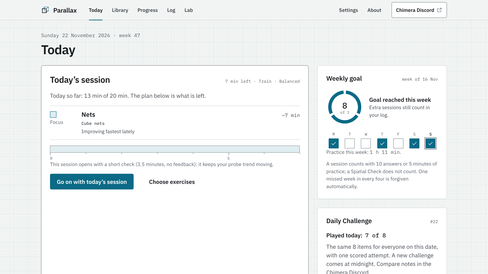

Built by the Chimera community on Discord: **[https://discord.gg/chmr](https://discord.gg/chmr)**

# Parallax

Parallax is a free, open-source web app that trains visuospatial ability: picturing objects as they turn, fold, are cut, or are seen from somewhere else. It runs offline in any modern browser and keeps everything on your device. Every exercise names the mechanism of transfer it bets on, and a built-in measure follows your own change on tasks you never train, so each player's record helps the community find out which bets pay.



Come and say hi in the [Chimera Discord](https://discord.gg/chmr): share your results and your pooled exports, and suggest exercises you would like to train.

The full user guide, with the research behind every design choice, is [docs/Parallax-Guide.pdf](docs/Parallax-Guide.pdf). What changed in version 1.2 is in [CHANGELOG.md](CHANGELOG.md).

## What it trains

Twenty exercises, every item generated fresh and checked by a solver, so each has exactly one right answer and cheap shortcuts score near chance:

- **Fourteen training exercises:** Track (3D multiple-object tracking, labelled attention practice), Rotate (3D mental rotation), Spin (2D speeded rotation), Fold (paper folding), Nets (cube nets), Slice (cross-sections), Views (orthographic views), Orient (perspective taking), Span (block span), Hidden (hidden shapes), Homing (facing the start after a walk, with landmarks; experimental), Reckon (dead reckoning on a plain with nothing to steer by; experimental), Knots (does a knot remain, which crossing unties or ties the rope, are two loops linked) and **Central Point**, new in 1.2: tap the spot with the least total distance to a set of marked dots, as a quick estimate against a clock by default or as an exact answer.
- **Six DAT-style formats, opt-in:** Openings, Missing View, Angles (labelled perceptual-judgement practice), Hole Punch, Painted Cubes and Form follow the question formats of the Perceptual Ability Test (PAT) in the Dental Admission Test (DAT®): lettered answers, plain line drawings, and a tag on every level that says whether its features sit below, inside or beyond the test's documented format. The tag describes the format, never the test's difficulty or a score. They join Train when you switch on the DAT-style focus; **Section practice** rehearses them under test conditions: every part's instructions before one clock, Back and Next across parts, Mark and Strike, and a review at the end (a mini section of 30 items in 20 minutes, or a full one of 90 in 60). It changes no level and forecasts no score. *DAT® and Dental Admission Test are marks of the American Dental Association. Parallax is not affiliated with or endorsed by the ADA. Every item is generated by the app; none is taken from the DAT.*

Each exercise starts with **Watch, Try, Go**, in two or three minutes: a slow worked example with captions, easy practice items with tips when you need them, then an easy scored start. Views, Central Point and the six DAT-style formats add a rules card, a strategy card before the first practice item, and that item's first step done for you.

## What it bets on

No theory of transfer has won, so Parallax spreads its bets. Every training exercise names the one mechanism it is built around: attention control (Track), load at the edge (Span), variety (Fold, Spin, Hidden), named strategies (Rotate, Orient), comparison (Nets, Knots), bridging (Slice), producing the answer (Views), format practice (the six DAT-style formats), and **calibration** (Reckon, Homing, Central Point): exact feedback on an intuitive estimate, a bet no study has tested yet.

Four add-ons put the bets to work between items: comparison rounds (two solved items side by side and the rule they share), bridge sets (the same problem in a real setting), draw-the-answer items (draw the view, mark the holes, mark the cut) and detailed feedback on your estimates. In the bet trials, which you can leave in Settings, each add-on comes with about half of its exercises in one period of at least 4 weeks and 8 sessions and with the other half in the next, at random. Your record logs how much of each bet you got, so the community's pooled exports form randomised trials of the bets.

The evidence so far: across 206 training studies, spatial practice raised spatial test scores by about half a standard deviation, and spatial tests nobody trained gained about as much (Uttal et al., 2013). Beyond spatial tests the evidence thins: gains in school mathematics were small and shown mainly in children and teenagers (Hawes et al., 2022). That open question is what the bets and the measure are for.

## How it measures

- **A starting point after one tutorial.** A new player meets one two-minute tutorial (Spin), then Baseline 1: about 11.5 minutes of short tasks without feedback, which you can also put off to your next session. Baseline 2 opens a session at least 12 hours later.
- **A ladder of tasks you never train:** a near probe (Other Way Round: the trained operations asked the other way round), three mid probes (Cube Match, View Match, Pattern Memory), two far probes (Mechanisms and Motion Graphs), Level (optional, reported on its own), and Word Links, a verbal control task.
- **Short blocks keep it moving.** About 3.5 minutes without feedback open up to four sessions a week, and a full check comes every 4 weeks. One model fits every occasion together and allows for familiarity with the tasks and for day-to-day ups and downs.
- **A meter and milestone words.** After each block the meter shows the chance that your probe composite has gone up, with a range. Words wait for milestones (2 weeks, 4 weeks, then every 4 weeks): "likely gain", "likely no change" (from week 8) or "unclear yet", which is not the same as no progress. In simulations of this design, a gain of about 1.3 standard deviations (the spread between people on these tasks) was read as a likely gain by 6 players in 10 at week 8, or about 1.0 if the tasks prove as reliable as the optimistic case, and false alarms stayed under 6 %.
- **Lab checks:** Balance, which checks whether Central Point's rule (every target pulls the same, however far) leaks into tasks where far points should count more; learning curves on the exercises added since 1.0; and a self-experiment that alternates phases.

Levels, probe points and meters compare you with yourself. Parallax shows no IQ, index, percentile, norm or "brain age".

## How it trains

- **At the edge on every dimension.** Train aims each item at the edge of your level (by default about three right in four on a four-option item). From 100 rated answers on an exercise, the engine also learns how hard each setting is for you, so items stay at your edge on every dimension, and in turn each dimension leads.
- **Plateaus get a change, and a reason.** When an exercise's last 640 rated answers, over at least 8 sessions on 8 days, show no progress, Parallax changes one thing: the interleaving stage, a drill of your weak setting, deadlines on items you already solve, a rest, the other strategy, another variant or a wider mix, or harder items. It says what changed and why, runs it for 3 sessions and 120 answers, and then tells you how it went.
- **Five ways to practise on one record:** Train (mixed, adaptive sessions), Path (ten gated stages per exercise), Threshold (staircases; for 3D tracking, a protocol after Legault et al. (2013), in Parallax's own units), Speed (deadlines once accuracy is there) and Free play. Each says in the app when it is the right one, and Today suggests one at a time from your log.
- **Feedback that explains:** after an answer, a slow, pausable "show me" built from the same model that graded it; two strategy cards per exercise, one picturing and one step by step, with advice on when to switch.

## The game

Goals you see at once and growth you can watch, without paying for time: grades 1 to 10 per exercise from your best block; Reach, the sum of your best levels, which never falls; an Atlas of the settings you have handled; the Daily Challenge, the same 8 items for everyone, from easy to hard, worth 1 to 8 points; the weekly Climb, 20 rungs and three seeded attempts a week, with a Summit for clearing them all; two field notes a week to aim at; and result cards to post. There are no daily streaks, no lifetime points for answers, no leaderboards, and a missed day costs nothing. Celebrations stay between items: nothing decorative runs while an item is on screen.

## Runs everywhere, and your data stays yours

- From a file, on GitHub Pages, in sandboxed previews and on phones. Every scored item fits a 360 × 640 screen; held sideways, items switch to two columns. Keyboard everywhere, 44-pixel touch targets, colour never the only cue, reduced motion respected.
- One active-time clock: it stops for the pause sheet, any open sheet or dialog, a hidden tab and after 60 seconds without input, and every screen shows the same minutes.
- No account, no analytics, no ads. Back up and restore as JSON, export trials as CSV, and share a community export from the Lab that carries no name unless you add your nickname, and no device details unless you tick them. A record from version 1.0 or 1.1 upgrades by itself, with nothing lost.

## Test hygiene

Practising a kind of puzzle raises scores on tests that use it. So exercises whose formats published tests share carry an "Also in tests" note, About gives the size of such practice effects, and a "Taking a test soon?" helper lists the matching exercises and can leave them out of Train until your test. If a test result matters to you, take the test before you practise its kind of puzzle here, or say how much you practised. There are no clones of clinical subtests such as Wechsler Block Design or Visual Puzzles, and Parallax is a practice tool, not a diagnostic one.

## Quick start

- **One file:** download `dist/Parallax.html` and open it in a browser. It inlines every script, stylesheet and font, so it works offline, from disk and in sandboxed previews.
- **The repository:** clone or download it and open `index.html`. There is nothing to build.
- **GitHub Pages:** push the repository to GitHub, then in the repository's **Settings → Pages** choose **Deploy from a branch**, the main branch and the root folder.

On the first open the Chimera welcome appears, then one short tutorial, then your starting point (or Later), then training. Later opens show a one-tap Chimera note under the header instead. The default routine is about 20 minutes, three times a week. On iPhone and iPad, Safari may clear site data after seven days without a visit: add Parallax to the home screen or back up.

## Running the tests

The whole suite in one command: the Node tests, then every browser test, two at a time, with a summary in `tests/e2e/out/run_all.json`. On GitHub, Actions runs the Node tests in four shards on every push and pull request (`.github/workflows/tests.yml`).

```sh
npm install
pip install playwright && python -m playwright install chromium
tests/run_all.sh                          # RUN_ALL_SKIP=longrun leaves out the long bot run
```

Node (generators with at least 10,000 seeds each, shortcut solvers, the engine, simulated learners):

```sh
npm test                                  # every exercise, probe and the engine
node tests/node/run.mjs rotate            # one exercise
node tests/node/run.mjs --shard 2/4       # one of four balanced shards, as CI runs them
node tests/node/sim.mjs --learners 200    # simulated learners over 60 days
```

Browser (Python Playwright, headless Chromium). `tests/e2e/pwslot.sh` lets at most two browsers run at once on one machine:

```sh
tests/e2e/pwslot.sh python3 tests/e2e/shell.py            # app shell, Chimera pop-up, settings
tests/e2e/pwslot.sh python3 tests/e2e/play.py             # the player, feedback, show me, sessions
tests/e2e/pwslot.sh python3 tests/e2e/flows.py            # tutorial, Spatial Check, Daily Challenge
tests/e2e/pwslot.sh python3 tests/e2e/screens.py          # Library, Progress, Log, Lab, share cards
tests/e2e/pwslot.sh python3 tests/e2e/game.py             # grades, the Climb, the Atlas, between items only
tests/e2e/pwslot.sh python3 tests/e2e/bets.py             # the bets, comparison rounds, bridge sets
tests/e2e/pwslot.sh python3 tests/e2e/clock.py            # the active-time clock, real time (about 30 min)
tests/e2e/pwslot.sh python3 tests/e2e/fit.py              # every scored item fits a phone screen
tests/e2e/pwslot.sh python3 tests/e2e/section.py          # Section practice, phone and desktop
tests/e2e/pwslot.sh python3 tests/e2e/overlap.py          # test hygiene: notes, helper, check question
tests/e2e/pwslot.sh python3 tests/e2e/harness_rotate.py   # one exercise in the dev harness (any id)
tests/e2e/pwslot.sh python3 tests/e2e/single.py           # the single-file build
tests/e2e/pwslot.sh python3 tests/e2e/longrun.py          # a bot plays 300 trials in each mode
```

Builds:

```sh
node tools/build-single.mjs                          # dist/Parallax.html
tests/e2e/pwslot.sh python3 tools/shots.py           # figures for the guide (docs/shots/)
tests/e2e/pwslot.sh python3 tools/build-pdf.py       # docs/Parallax-Guide.pdf from docs/guide/
```

## Repository layout

```
index.html            the app (classic scripts on window.PX, loaded in a fixed order)
js/core/              random numbers, the active-time clock, timing, keys, storage, routing, the shared 3D stage
js/engine/            ratings, item choice, modes, dimensions, plateaus, bets, measurement, the game layer (pure, runs in Node)
js/ex/<id>/           one folder per exercise or probe: gen.js, learn.js, view.js (and layers.js for add-ons)
js/ui/                screens: Today, player, Section practice, Library, Progress, Log, Lab, Settings, About, the Climb, the Atlas
css/                  design tokens, app, screens, player, one stylesheet per exercise
tests/node/           generator, engine and simulation tests
tests/e2e/            browser tests (Python Playwright)
tests/dev/            the development harness (harness.html?ex=<id>)
tests/run_all.sh      the whole suite: Node, then every browser test
.github/workflows/    GitHub Actions: the Node tests in four shards on every push
tools/                single-file build, guide figures and PDF, three.js vendoring, the privacy check
docs/                 the user guide (guide/, Parallax-Guide.pdf, shots/), developer notes (dev/) and research notes (research/)
icons/                app icons for the home screen; manifest.webmanifest lists them
dist/                 Parallax.html, the single-file build
vendor/               three.js (MIT, with its licence file)
fonts/                IBM Plex Sans and Mono (SIL OFL 1.1)
```

## Contributing

New exercises, better items, translations, accessibility fixes and analyses of pooled data are all welcome, and the pooled exports are where the bets get tested. Start with [docs/dev/EXERCISE-GUIDE.md](docs/dev/EXERCISE-GUIDE.md), which builds one exercise (Rotate) end to end, and [docs/dev/ENGINE.md](docs/dev/ENGINE.md), which explains every formula and default of the engine. The house rules: every claim matches the evidence and the code; no clones of clinical subtests and no copied test items; every item verified by a solver, with cheap shortcuts near chance; timing from frame timestamps; keyboard and touch everywhere; every scored item fits a 360 × 640 screen. Talk ideas over first on the [Chimera Discord](https://discord.gg/chmr).

## Licences

- Code, code comments and code examples: MIT ([LICENSE](LICENSE)).
- Texts: the user guide's text and figures, this README, the CHANGELOG and the prose notes in `docs/`: Creative Commons Attribution-ShareAlike 4.0 ([LICENSE-GUIDE.md](LICENSE-GUIDE.md)).
- three.js: MIT, © three.js authors ([vendor/LICENSE-three.txt](vendor/LICENSE-three.txt)).
- IBM Plex Sans and IBM Plex Mono: SIL Open Font License 1.1 ([fonts/OFL.txt](fonts/OFL.txt)).
